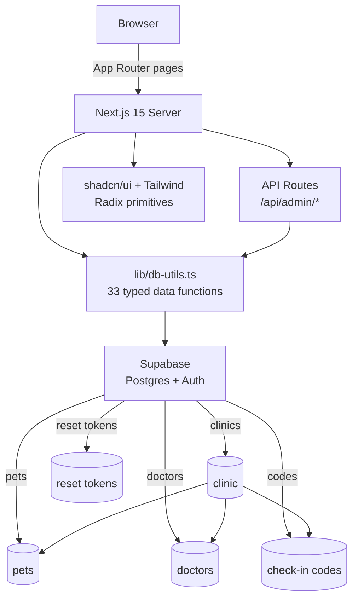

# vet-checkin

A production-shaped veterinary clinic check-in and operations app, built with
**Next.js 15 (App Router)**, **React 19**, **TypeScript**, **Tailwind CSS** and
**shadcn/ui**, backed by **Supabase**.

Multi-tenant by design: every clinic sees only its own patients, doctors and
check-in codes, and clinic signup is gated by an admin-issued code.

---

## Features

| Area | What it does |
|---|---|
| **Clinic onboarding** | Signup gated by an admin-issued code; email/password login with password-reset tokens (single-use, marked used on redemption). |
| **Check-in codes** | Issue, list, verify and deactivate per-clinic check-in codes. `verifyCode` is the front-desk path used at check-in time. |
| **Patient records** | Full CRUD with **soft delete** and **restore** so a mis-delete is never destructive. Filterable by status and by doctor. |
| **Doctor records** | Per-clinic doctor list, active-only filtering, create/update/delete. |
| **Dashboard** | Per-clinic stats plus views for pets, doctors, check-in codes and the clinic's own profile. |
| **Admin panel** | Separate admin login, cross-clinic dashboard, and clinic removal. |
| **Theme** | `next-themes` with light/dark support. |

---

## Architecture



Every data function goes through `lib/db-utils.ts`, so no page talks to
Supabase directly. That keeps tenant scoping and soft-delete semantics in one
auditable place instead of scattered across UI code.

---

## Stack

- **Next.js 15.2.4** (App Router) · **React 19** · **TypeScript 5**
- **Tailwind CSS 3** + **shadcn/ui** (Radix UI primitives, `cva`, `tailwind-merge`)
- **Supabase** (`@supabase/supabase-js` 2.x) for Postgres + Auth
- **react-hook-form** + **zod** for form handling and validation
- **recharts** for dashboard charts · **lucide-react** / **react-icons** for icons

---

## Getting started

```bash
npm install
cp .env.example .env.local   # then fill in your Supabase values
npm run dev                   # http://localhost:3000
```

### Environment variables

All secrets are read from the environment; none are committed (`.env*` is
git-ignored).

| Variable | Used by | Purpose |
|---|---|---|
| `NEXT_PUBLIC_SUPABASE_URL` | browser + server | Supabase project URL |
| `NEXT_PUBLIC_SUPABASE_ANON_KEY` | browser | Public anon key |
| `SUPABASE_URL` | server only | Supabase project URL (server context) |
| `SUPABASE_ANON_KEY` | server only | Public anon key (server context) |

### Scripts

| Command | Action |
|---|---|
| `npm run dev` | Start the dev server |
| `npm run build` | Production build (type-checked - no `ignoreBuildErrors`) |
| `npm start` | Serve the production build |
| `npm run lint` | ESLint over `.ts`/`.tsx` |
| `npm run typecheck` | `tsc --noEmit` |
| `npm run db:types` | Regenerate `lib/database.types.ts` from your Supabase project |

### Typed database access

The Supabase client is typed with `lib/database.types.ts`, so `supabase.from("pets")`
returns a typed row instead of `any`. Regenerate it after a schema change:

```bash
export SUPABASE_PROJECT_ID=<your-project-ref>
npm run db:types
```

The file follows the same shape as `supabase gen types`, so it can be replaced
wholesale without touching any call site.

---

## Project layout

```
app/
  page.tsx                     landing page
  login/ signup/ reset-password/
  dashboard/
    page.tsx                   clinic stats
    pets/ edit-pet/ codes/ doctors/ profile/
  admin/
    login/ dashboard/          cross-clinic admin surface
  api/admin/delete-clinic/     admin API route
components/
  ui/                          shadcn/ui primitives
  check-in-form.tsx            check-in capture
  image-carousel.tsx           pet media gallery
  pet-details.tsx              patient detail panel
hooks/                         typed client hooks
lib/
  supabase.ts                  server + browser clients
  db-utils.ts                  all data access
  utils.ts                     `cn()` class-name helper
```

---

## Notes on data integrity

- **Soft delete** — pets are archived rather than removed, and `restorePet`
  brings them back. Deletes are reversible by design.
- **Single-use tokens** — password-reset and clinic-signup tokens are marked
  used once redeemed, so a leaked token cannot be replayed.
- **Tenant scoping** — pets and doctors are always filtered by `clinicId`.
- **Error handling** — every data function returns `null` or
  `{ success: false, error }` instead of throwing, so callers handle failures
  explicitly.

---

## License

MIT © 2026 Sajjad Rabby. See [LICENSE](LICENSE).
